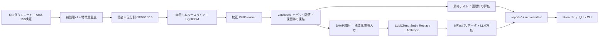

# MedRisk Audit Lab

> 臨床リスク予測モデルを「監査」する再現可能なプラットフォーム — 30日再入院予測を題材に、リーク防止・校正・公平性・回答保留・制約付きLLM説明の定量評価までを一貫して実装

**English version: [README_EN.md](README_EN.md)**

## ⚠️ 免責(必ずお読みください)

本プロジェクトは**研究・教育・ポートフォリオ実証のみ**を目的とし、**医療機器ではありません**。診断・治療判断・トリアージ・実患者に関する意思決定には一切使用できません。実在する患者情報を入力しないでください。使用データは**1999〜2008年の米国病院データ**であり、現在の医療現場および日本の医療には一般化できません。

## ステータス

v1.0 — 全マイルストーン(v0.1〜v1.0)実装済み。最終テスト評価は1回のみ実行済み。GitHub公開は `docs/RELEASE_CHECKLIST.md` の人手確認後。

## これは「よくある再入院分類プロジェクト」ではありません

精度を競うのではなく、**モデルを監査対象として扱う**ことが本体です:

- **患者単位分割** — `patient_nbr` による train/calibration/validation/final-test の4分割。分割間の患者非重複はCIで自動検証
- **最終テストの完全隔離** — 全設定(モデル・校正・閾値・保留帯)を validation で凍結後、専用コマンドで**1回だけ**評価。再実行はコードが拒否
- **確率の品質** — Platt校正で ECE 0.32 → 0.009。信頼性曲線・校正slope/interceptを公開
- **患者単位ブートストラップ95%CI** — 全指標に付与
- **公平性監査** — race/gender/age 別の指標を必ず n と CI 付きで報告。50患者未満の群は「結論不可」と明示し、断定しない
- **回答保留(abstention)** — 不確実帯では「信頼できる予測なし」を返す。coverage 89.8% で selective F1 改善
- **制約付きLLM説明の定量評価** — LLMは説明コンポーネントであり予測器ではない。104件の版管理された評価ケース・8次元のバリデータ・3条件比較・**失敗例の公開**
- **シークレット安全なCI** — fork PR にシークレットを渡さず、有償API呼び出しゼロ。gitleaks を pre-commit/CI/全履歴で実行

## クイックスタート(APIキー不要)

Python ≥ 3.12 と [uv](https://docs.astral.sh/uv/) が必要です:

```bash
uv sync                                          # 依存関係(固定版)
uv run medrisk pipeline                          # データ取得(SHA-256検証)→前処理→分割→ベースライン
uv run pytest                                    # テスト(分割非重複検証を含む)
uv run streamlit run apps/streamlit_app/app.py   # デモUI(Demo LLM Mode・鍵不要)
```

追加ステージ(すべて鍵不要): `train-main` `ablation` `explain` `audit` `llm-cases` `llm-generate` `llm-eval`。macOS で LightGBM が libomp エラーになる場合は `scripts/fix_lightgbm_macos.sh`(または `brew install libomp`)。

Live LLM Mode(任意・既定無効)は `MEDRISK_LLM_MODE=live` とローカルの `ANTHROPIC_API_KEY` を設定した場合のみ有効になります。鍵がなくても他機能は一切壊れません。

## 最終テスト結果(1回限りの評価・n=15,076)

| 指標 | 値 | 95% CI(患者ブートストラップ) |
|---|---|---|
| AUROC | 0.688 | [0.674, 0.702] |
| AUPRC(有病率 0.117) | 0.244 | [0.224, 0.266] |
| Brier score | 0.098 | [0.093, 0.102] |
| Recall(閾値0.16) | 0.384 | [0.358, 0.412] |
| Specificity | 0.844 | [0.836, 0.852] |
| ECE | 0.009 | [0.005, 0.015] |

判別性能は本データセットの公表結果と同水準の中程度です。**本プロジェクトの価値は監査手法にあり、スコアではありません。** 詳細: [`reports/final/FINAL_REPORT.md`](reports/final/FINAL_REPORT.md)、失敗例: `reports/llm/failure_examples.json`、`reports/explain/error_analysis.json`。

## アーキテクチャ



LLM出力に含まれる保存済みデモは**決定論的な StubClient が生成したもの**であり、その旨を全成果物に明記しています(実LLM呼び出しは行っていません)。

## ドキュメント

| 文書 | 内容 |
|---|---|
| [`docs/DATA_CARD.md`](docs/DATA_CARD.md) | 全50カラムの採用/除外監査・コホート定義・ライセンス |
| [`docs/MODEL_CARD.md`](docs/MODEL_CARD.md) | モデル仕様・最終テスト結果・使用範囲 |
| [`docs/ETHICS_AND_LIMITATIONS.md`](docs/ETHICS_AND_LIMITATIONS.md) | 倫理的配慮と限界 |
| [`docs/SECURITY_DESIGN.md`](docs/SECURITY_DESIGN.md) | 脅威モデル・CI設計・インシデント対応 |
| [`docs/ARCHITECTURE.md`](docs/ARCHITECTURE.md) ほか | 設計文書一式(9本) |
| [`docs/RELEASE_CHECKLIST.md`](docs/RELEASE_CHECKLIST.md) | GitHub公開前チェックリスト |

## 禁止事項

診断・治療推奨・救急トリアージ・実患者データの処理。SHAP属性を因果的・臨床的根拠として提示すること。検証されていないLLM出力を医学的事実として提示すること。

## ライセンス

データセット: CC BY 4.0(UCI ML Repository, Strack et al. 2014)。コードのライセンスは公開前に決定予定です。
