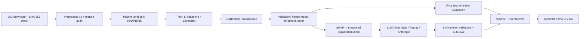

# MedRisk Audit Lab

> A reproducible audit platform for a clinical risk model — 30-day hospital
> readmission prediction subjected to leak-proof evaluation, calibration,
> fairness auditing, abstention, and quantitative evaluation of constrained
> LLM explanations

**日本語版: [README.md](README.md)**

## ⚠️ Disclaimer (read first)

This project exists for **research, education, and portfolio demonstration
only**. It is **not a medical device** and must never be used for
diagnosis, treatment decisions, triage, or any decision about real
patients. Never enter real patient data. The dataset covers **US hospitals
from 1999–2008**; results do not generalize to current clinical practice or
to present-day Japanese healthcare.

## Status

v1.0 — all milestones (v0.1–v1.0) implemented; the final-test evaluation
has been executed exactly once. Public GitHub release pends the human
checklist in `docs/RELEASE_CHECKLIST.md`.

## Why this is not another readmission classifier

The classifier is the *subject under audit*, not the deliverable:

- **Patient-level splits** — train/calibration/validation/final-test by
  `patient_nbr`; non-overlap is enforced by a CI test
- **Final-test isolation** — every setting (model, calibration, threshold,
  abstention band) frozen on validation first; a dedicated command
  evaluates the test split **once** and refuses to run twice
- **Probability quality** — Platt calibration takes ECE from 0.32 to
  0.009; reliability curves and calibration slope/intercept are published
- **Patient-bootstrap 95% CIs** on every metric
- **Fairness audit** — race/gender/age metrics always paired with group
  size and CI; groups under 50 patients are labeled inconclusive, no
  claims made
- **Abstention** — "no reliable prediction" inside the uncertainty band;
  89.8% coverage with improved selective F1
- **Quantified LLM constraints** — the LLM explains, never predicts:
  104 versioned cases, validators for eight dimensions, three compared
  conditions, and **published failure examples**
- **Secret-safe CI** — no secrets for fork PRs, zero paid API calls,
  gitleaks in pre-commit, CI, and full history

## Quickstart (no API key required)

Requires Python ≥ 3.12 and [uv](https://docs.astral.sh/uv/):

```bash
uv sync                                          # pinned dependencies
uv run medrisk pipeline                          # download (SHA-256 verified) → preprocess → split → baseline
uv run pytest                                    # test suite (incl. split non-overlap)
uv run streamlit run apps/streamlit_app/app.py   # demo UI (Demo LLM Mode, key-free)
```

Further key-free stages: `train-main`, `ablation`, `explain`, `audit`,
`llm-cases`, `llm-generate`, `llm-eval`. On macOS, if LightGBM cannot load
libomp, run `scripts/fix_lightgbm_macos.sh` (or `brew install libomp`).

Live LLM Mode (optional, off by default) activates only with
`MEDRISK_LLM_MODE=live` plus a local `ANTHROPIC_API_KEY`; a missing key
never breaks anything else.

## Final-test results (one-shot evaluation; n=15,076)

| Metric | Value | 95% CI (patient bootstrap) |
|---|---|---|
| AUROC | 0.688 | [0.674, 0.702] |
| AUPRC (prevalence 0.117) | 0.244 | [0.224, 0.266] |
| Brier score | 0.098 | [0.093, 0.102] |
| Recall (threshold 0.16) | 0.384 | [0.358, 0.412] |
| Specificity | 0.844 | [0.836, 0.852] |
| ECE | 0.009 | [0.005, 0.015] |

Discrimination is moderate and consistent with published results on this
dataset. **The value of this project is the audit methodology, not the
score.** Details: [`reports/final/FINAL_REPORT.md`](reports/final/FINAL_REPORT.md);
failures: `reports/llm/failure_examples.json`,
`reports/explain/error_analysis.json`.

## Architecture



Stored LLM demo outputs were generated by a **deterministic StubClient**
and are labeled as such everywhere — no live LLM was called.

## Documentation

| Document | Contents |
|---|---|
| [`docs/DATA_CARD.md`](docs/DATA_CARD.md) | 50-column feature audit, cohort, license |
| [`docs/MODEL_CARD.md`](docs/MODEL_CARD.md) | Model spec, final-test results, intended use |
| [`docs/ETHICS_AND_LIMITATIONS.md`](docs/ETHICS_AND_LIMITATIONS.md) | Ethics and limits |
| [`docs/SECURITY_DESIGN.md`](docs/SECURITY_DESIGN.md) | Threat model, CI security, incident response |
| [`docs/ARCHITECTURE.md`](docs/ARCHITECTURE.md) et al. | The nine design documents |
| [`docs/RELEASE_CHECKLIST.md`](docs/RELEASE_CHECKLIST.md) | Pre-publication checklist |

## Prohibited uses

Diagnosis, treatment recommendations, emergency triage, processing real
patient data, presenting SHAP attributions as causal or clinical evidence,
presenting unvalidated LLM output as medical truth.

## License

Code: [MIT License](LICENSE). Dataset: CC BY 4.0 (UCI ML Repository;
Strack et al., 2014).
