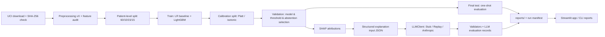

# Architecture

## System overview

MedRisk Audit Lab is a local-first Python project: a tested package
(`medrisk`) implementing the audit pipeline, a CLI driving each stage, and a
Streamlit demo app on top. Three operating modes share the same artifacts:

| Mode | Requires API key | Content |
|---|---|---|
| Core ML Mode | No | Full ML pipeline: data → training → audit artifacts |
| Demo LLM Mode (default LLM mode) | No | Stored LLM explanations and stored evaluation results |
| Live LLM Mode | Yes (local, opt-in) | Fresh LLM explanations through the same contract |

## Planned repository layout

Created during implementation (not in the design phase):

```
src/medrisk/
  data/         # download, checksum, preprocessing, patient-level splitting
  models/       # baselines, LightGBM, calibration
  evaluation/   # metrics, bootstrap CIs, thresholds, subgroup, abstention
  explain/      # SHAP computation and attribution formatting
  llm/          # LLMClient interface + Stub/Replay/Anthropic clients, validators
  reporting/    # run manifests, JSON/plot report generation
apps/streamlit_app/
configs/        # versioned YAML configs and seeds
scripts/        # thin entry points (download, etc.)
tests/
reports/        # committed aggregate outputs (metrics JSON, plots, LLM eval)
data/           # gitignored raw and processed data
docs/
```

## Component boundaries

- `data` knows nothing about models; it produces typed, versioned datasets
  and split ID lists.
- `models` consumes splits, never reads raw files directly.
- `evaluation` is pure: given predictions and labels it returns metrics; it
  contains the only code path that may load the final test split (FR-4).
- `explain` consumes a fitted model and a dataset; produces attribution
  artifacts.
- `llm` consumes **only** structured JSON built from stored artifacts; it has
  no access to raw data or the model object.
- `reporting` owns run manifests and rendering; no other module writes to
  `reports/`.
- The Streamlit app and the CLI are thin shells over the package; no business
  logic lives in them.

## Data flow



## ML pipeline

Stages, each idempotent and CLI-addressable: `download` → `preprocess` →
`split` → `train` → `calibrate` → `evaluate` → `explain` → `report`.
Every stage reads a versioned YAML config and a seed, and appends to the run
manifest (dataset checksum, preprocessing version, split hash, config hash,
package versions, git commit, metrics). Split, isolation, and metric rules
are defined in `DATA_AND_MODEL_PLAN.md`.

## LLM pipeline

- A single interface, `LLMClient`, with three implementations:
  - **StubClient** — deterministic template output; used in unit tests.
  - **ReplayClient** — returns stored outputs from `reports/llm/`; powers
    Demo LLM Mode and CI evaluation.
  - **AnthropicClient** — Live LLM Mode only; constructed only when
    `MEDRISK_LLM_MODE=live` and a key exists in the environment.
- Mode resolution: `MEDRISK_LLM_MODE` ∈ {`demo` (default), `live`, `off`}.
  Missing keys in `demo`/`off` are never consulted; in `live` a missing key
  produces a clear message and a fallback to `demo`.
- The prompt contract, input/output schemas, and validators are specified in
  `LLM_EVALUATION_PLAN.md`. Validators run on every LLM output regardless of
  client; unvalidated text never reaches the UI.

## UI

- Streamlit pages: Overview & disclaimer, Model results, Calibration &
  thresholds, Subgroup audit, Abstention, LLM explanations (Demo default),
  LLM evaluation (including failures).
- No free-text medical input (FR-14). A persistent footer carries the
  non-medical-device disclaimer.
- A REST API (FastAPI) is intentionally **not** part of v1.0; it is listed as
  a future extension to avoid overengineering.

## Storage and logging

- Raw/processed data: local `data/` only, gitignored.
- Committed artifacts: split ID lists (de-identified integer patient keys
  from an already de-identified public dataset), configs, aggregate metrics,
  plots, LLM evaluation records, run manifests.
- Logging: structured, INFO-level pipeline progress only. Never logged:
  API keys, environment contents, raw feature rows, LLM prompts/outputs in
  live mode (unless the explicit persist flag is used).

## Testing and deployment

- Tests: unit (each module), property/contract (split non-overlap,
  determinism, validator correctness), integration (pipeline on a small
  committed synthetic fixture that mimics the schema — the real dataset is
  not required in CI), and validator runs over stored LLM outputs.
- CI (GitHub Actions): ruff, mypy, pytest, gitleaks on every push/PR;
  no secrets exposed to fork PRs; no paid API calls (`SECURITY_DESIGN.md`).
- Deployment: v1.0 is local-run plus committed reports. A public demo
  (Streamlit Community Cloud, Demo LLM Mode only, Live disabled) is a
  separately approved post-v1.0 step.
