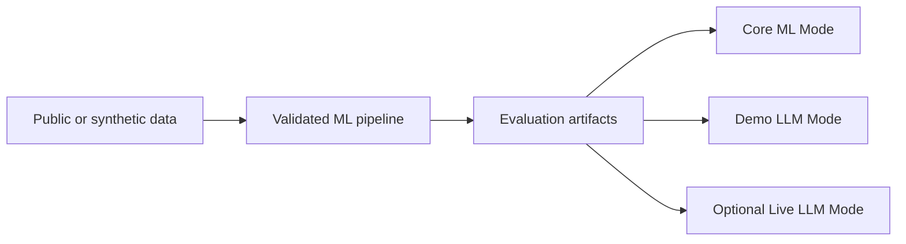

# Architecture

## System overview

TBD during the approved design phase

## Component boundaries

TBD during the approved design phase

## Data flow

TBD during the approved design phase

## ML pipeline

TBD during the approved design phase

## LLM pipeline

TBD during the approved design phase

## API and UI

TBD during the approved design phase

## Storage and logging

TBD during the approved design phase

## Testing and deployment

TBD during the approved design phase

## Architecture diagram

